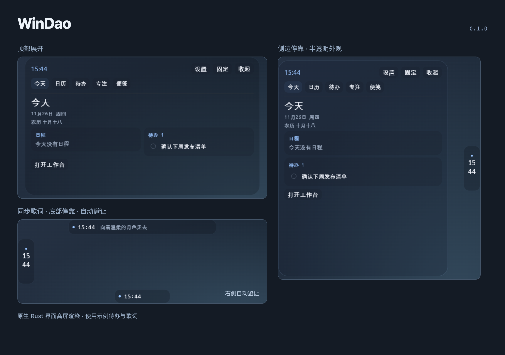

<div align="center">
  
</div>

<h1 align="center">WinDao</h1>

<p align="center"><strong>停在屏幕边，展开就是今天。</strong></p>
<p align="center">Windows 原生桌面胶囊，把日程、待办、音乐和系统状态放在手边。</p>
<p align="center">
  <a href="https://github.com/GpsLypy/windao/releases/tag/v0.1.0"><strong>下载 Windows 版</strong></a>
  · <a href="docs/source-guide.md">使用指南</a>
  · <a href="CHANGELOG.md">更新记录</a>
  · <a href="https://github.com/GpsLypy/windao/issues">反馈问题</a>
</p>
<p align="center">Windows 11 x64 · Rust / egui · MIT</p>



## 屏幕四边，选你顺手的一边

胶囊平时贴边显示，点击或悬停后朝屏幕内展开。可以调整大小和沿边位置，指定显示器，也可以按住 Ctrl 拖动收起的胶囊换边或跨屏。可开启半透明或极简模式，按习惯隐藏或拖动排序功能页。浏览器或指定应用遮住胶囊时会收成一条线。OLED 像素偏移与截图、录屏隐藏可在设置中开启。

## 日程、待办与专注

月历可逐日浏览，并离线显示 1901–2100 年的农历和节气。编辑日程时可选择时分。支持本地日程、ICS 导入导出、HTTPS ICS 订阅与只读 CalDAV。待办支持按星期重复和四象限，可从胶囊直接完成。专注计时结束后会留下记录，也可以独立设置饮水和起身提醒。工作台的「通知」可回看最近 100 条由 WinDao 发出的提醒。

通知页可手动开启微信、企业微信、飞书和钉钉的任务栏提示记录。WinDao 验证应用签名后，仅保存应用名称和闪烁时间。

## 音乐与歌词

WinDao 从 Windows 系统媒体会话读取当前曲目、封面和进度。根据播放器提供的能力，可播放、暂停、切歌和拖动进度。歌词支持本地 LRC 和手动查询 LRCLIB，音乐页可浏览同步歌词并跟随当前行，顶部收起时显示一行。

## 系统性能与桌面工具

在工作台查看 CPU、内存和实时网速，以及本地时间和常用城市的时间。「我的日子」可记下重要日期，查看还有几天或已过去几天。工具页提供文件暂存、按需刷新现货金价，以及按自设工时计算的日薪进度。剪贴板历史可手动开启，本次运行结束后清空。便笺、卡片与会议笔记保存在本机。

天气支持搜索城市和查看七日预报。无线设备页显示已配对的蓝牙设备，兼容低功耗蓝牙设备可按需读取电量。「插件集市」可安装随包模板和 WinDao 在线目录的组件，也可导入本地文本、链接或清单组件。组件数据保存在本机。[组件格式说明](docs/widget-manifest.md)

## 下载安装

在 [GitHub Releases](https://github.com/GpsLypy/windao/releases/tag/v0.1.0) 选择安装版 EXE，或解压 ZIP 后运行 `WinDao.exe`。托盘菜单可打开工作台，`Ctrl+Shift+Space` 呼出胶囊。工作台内用 `Ctrl+Tab` 和 `Ctrl+Shift+Tab` 切换下一页和上一页。当前提供未签名的 Windows 11 x64 预览包。

## 从源码构建

在装有 Windows SDK、MSVC C++ 构建工具和 Rust 1.92 或更高版本的 Windows 上运行。

```powershell
cargo test --locked
cargo run --locked
cargo build --release --locked
```

使用 Python 3.11 或更高版本运行 `python package.py target/release/windao.exe` 可生成 ZIP。安装 NSIS 3 后加 `--makensis makensis` 可同时生成安装包。

## 开源与致谢

WinDao 以 [MIT](LICENSE) 许可开源。感谢 [岛仔 · Daozai](https://github.com/Renly1994/xiaotang-daozai) 提供交互与模块设计参考。[实现对照](docs/daozai-comparison.md) 记录了对岛仔 v0.6.70 的 README、发布说明及源码的核对结果。内置 [Noto Sans SC 字体](assets/fonts/OFL-NotoSansSC.txt) 按 SIL Open Font License 1.1 分发。[第三方依赖许可](THIRD_PARTY_NOTICES.txt)随安装包提供。
