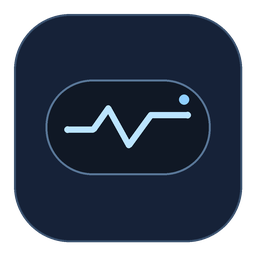
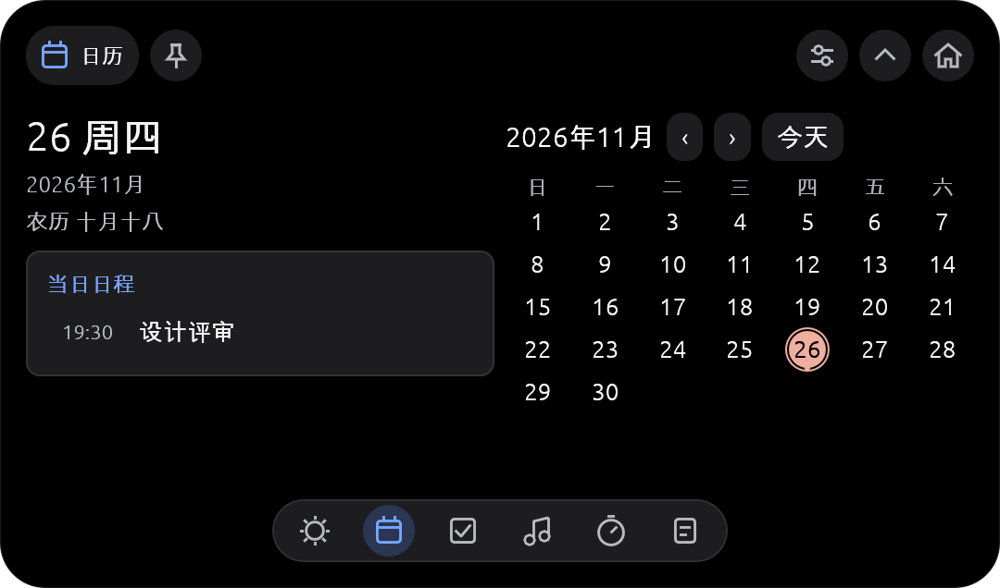
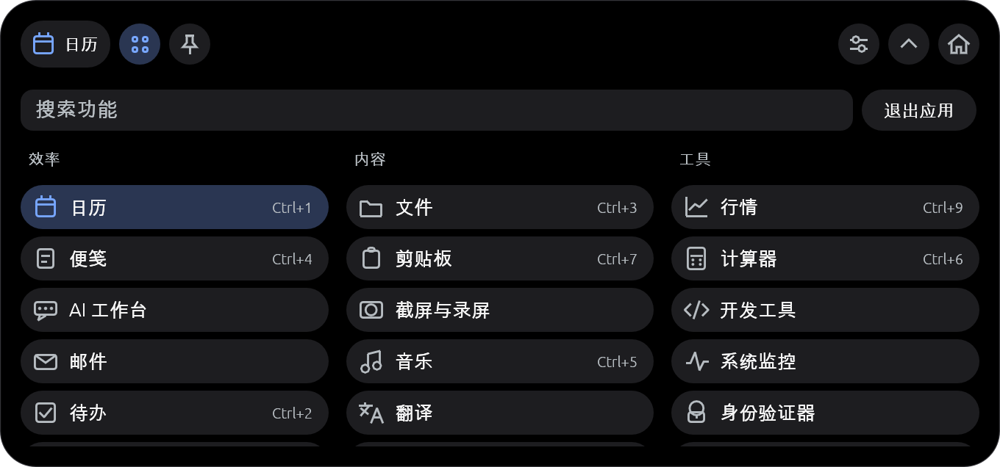
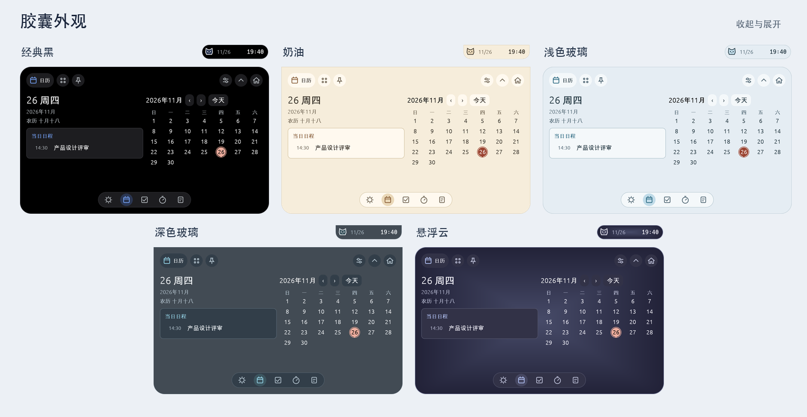
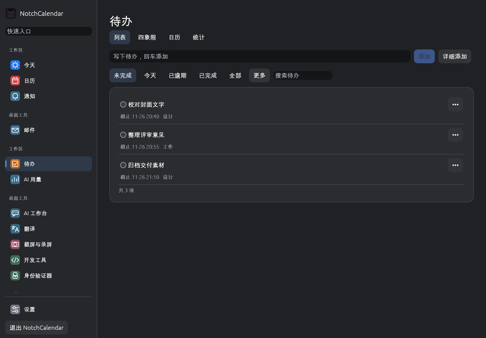
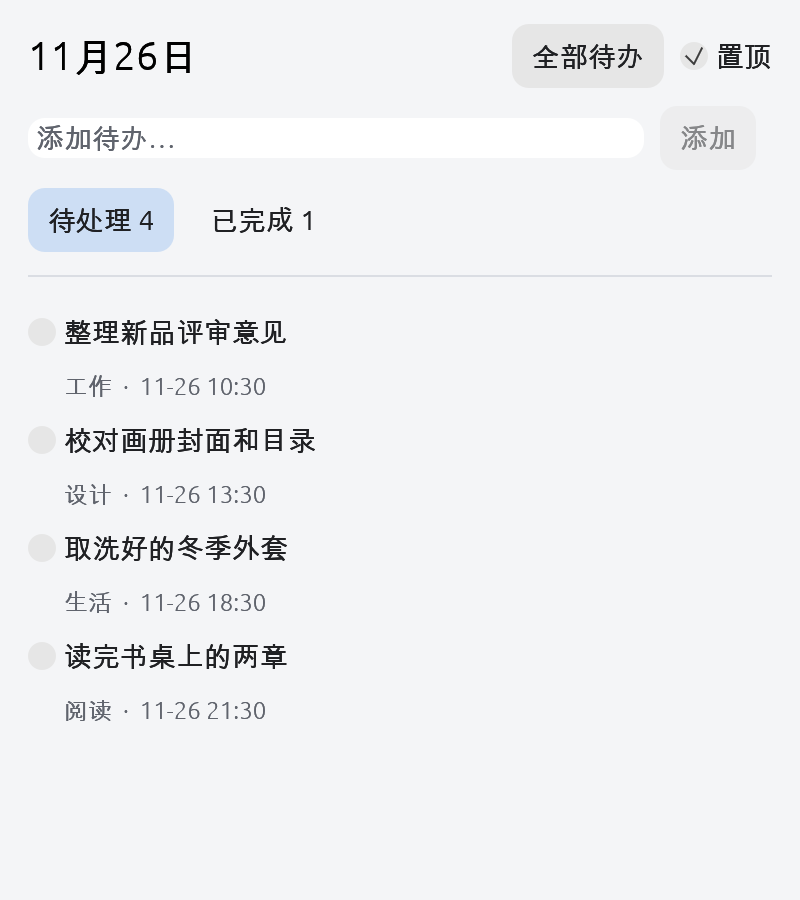
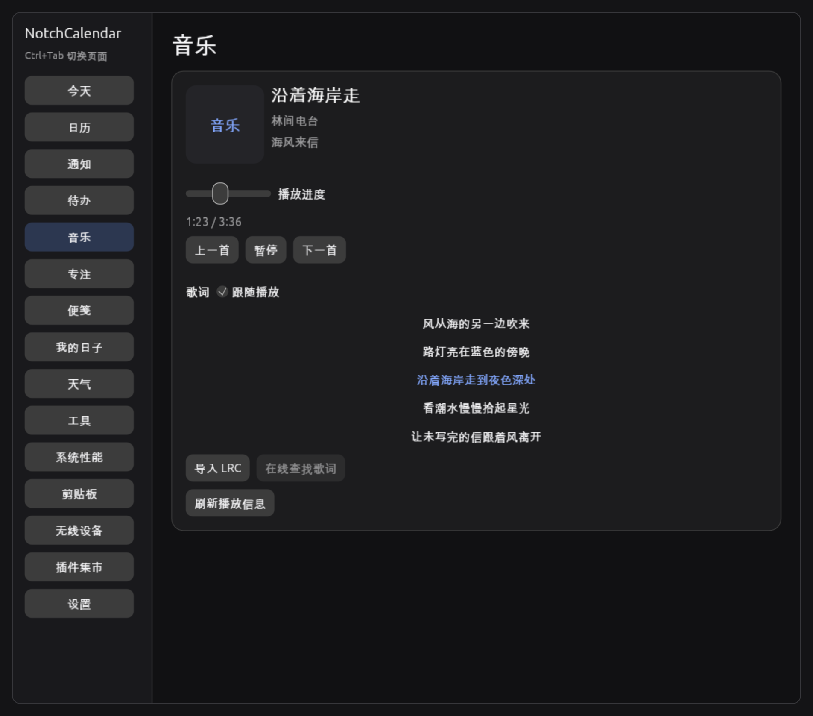
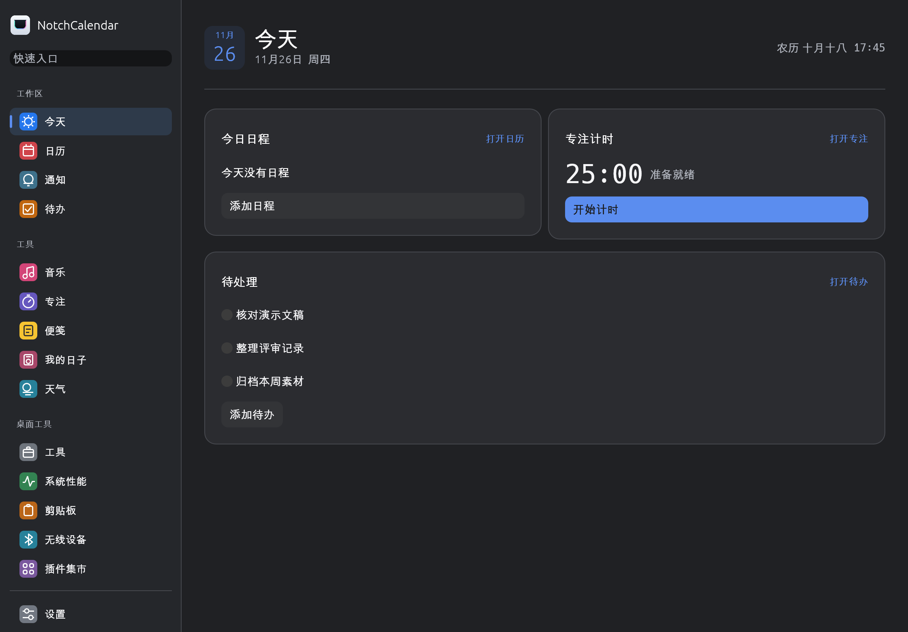
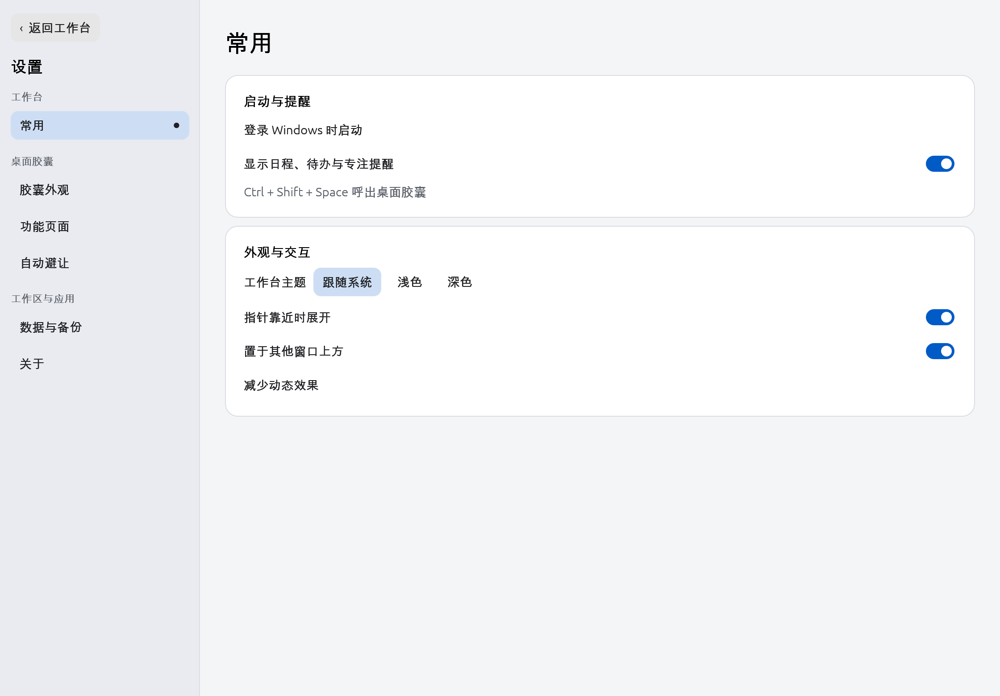
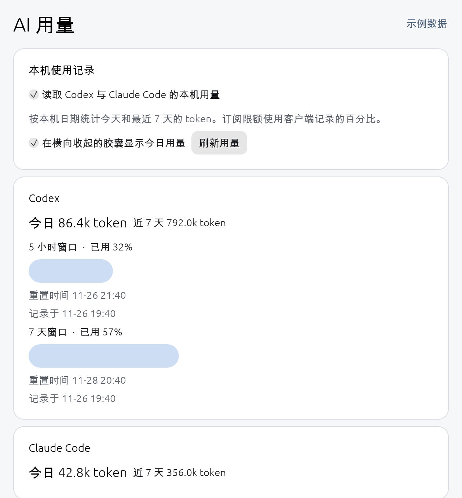

<div align="center">
  
  <h1>NotchCalendar</h1>
  <p>贴在 Windows 屏幕边缘的桌面胶囊。展开就能看日程、勾待办、切歌或开始专注。</p>
  <p>
    <a href="#下载安装"><strong>下载 Windows 版</strong></a>
    · <a href="docs/source-guide.md">使用指南</a>
    · <a href="CHANGELOG.md">更新记录</a>
    · <a href="https://github.com/GpsLypy/windao/issues">反馈问题</a>
  </p>
  <p>Windows 10 2004+ / 11 x64 · Rust / egui · MIT</p>
</div>

**功能一览** · [四边停靠](#四边停靠) · [日历与待办](#日历与待办) · [音乐与歌词](#音乐与歌词) · [通知记录](#通知记录) · [专注与健康提醒](#专注与健康提醒) · [文件与剪贴板](#文件与剪贴板) · [邮箱](#邮箱) · [AI 用量](#ai-用量) · [桌面工具](#桌面工具)

## 四边停靠

平时只占屏幕边缘一小条。鼠标靠近或按 **Ctrl + Shift + Space** 展开日历。点标题旁的「功能菜单」，可从「效率」「内容」「工具」三组打开待办、文件、音乐、行情等功能。





*以下图片由 Windows 版实际使用的 Rust 界面在 macOS 上离屏渲染。日程、待办和播放信息使用示例数据，系统开关状态用于展示布局。Windows 实机使用系统字体。*

- **换边或跨屏**。按住 Ctrl 拖动收起的胶囊即可换边，也可以在设置中指定显示器、停靠位置和缩放。
- **按习惯显示**。可设为极简或半透明外观，选择 12／24 小时制，拖动调整胶囊内的页面顺序。
- **给当前应用让位**。浏览器或指定应用挡住胶囊时，胶囊收成贴边细线。可选 OLED 像素偏移，以及在兼容的截图和录屏工具中隐藏胶囊。

在「设置 → 胶囊外观」可切换经典黑、奶油、浅色玻璃、深色玻璃和悬浮云，也可选胶囊或贴边刘海以及猫咪挂件。悬浮云会使用播放器提供的封面颜色。



## 日历与待办

展开胶囊即可看月历和当天安排。从功能菜单打开「桌面待办」，可在独立悬浮窗里输入事项、按 Enter 添加、勾选完成。关闭工作台后，悬浮窗仍可使用。



| 想做的事 | 在哪里操作 |
| --- | --- |
| 看今天有哪些安排 | 在「日历」选中日期，看当天事项、农历和节气。农历与节气支持离线查看 |
| 连接已有日历 | 在「日历来源」选择飞书、钉钉、企业微信、iCloud、ICS、CalDAV 或 Exchange ActiveSync。远程日历只读，断网可查看已同步日程 |
| 提前准备会议 | 同一场会议通过日历及邮件到达时合为一条。支持开始时提醒或提前 5、10、15、30、60 分钟提醒 |
| 新建或搬运日程 | 新建本地日程并选择开始、结束时间，或导入和导出 `.ics` 文件 |
| 分清轻重缓急 | 在「待办」切换列表、四象限、日历或统计。可设每周重复，在胶囊里直接完成当天待办，也可导入岛仔待办 |



## 音乐与歌词

「音乐」从 Windows 系统媒体会话读取曲名、歌手、封面和播放进度。播放器提供相应控制时，可以**播放、暂停、切歌和拖动进度**。



- **展开看整首**。歌词可随播放进度滚动，也可以暂停跟随，手动阅读。
- **收起留一行**。顶部停靠时，胶囊可在收起状态显示当前歌词。
- **调播放器音量**。音乐页和展开的音乐胶囊均可调整播放器音量及静音。音量控件需要能与播放器来源匹配的 Windows 音频会话。
- **网易云歌词**。可粘贴网易云歌曲链接或数字 ID 直接查找，也可导入本地 LRC。自动查找时，网易云曲目先用歌名、歌手、专辑和时长匹配唯一的歌曲 ID；无法确认时再从 LRCLIB 查找。
- **国产播放器**。网易云音乐、QQ 音乐、酷狗和汽水音乐优先使用系统媒体会话。如果客户端缺少歌手信息，会核对同一播放器的窗口标题。仅能识别窗口标题时可显示曲目信息；切歌、定位、自动滚动歌词仍需播放器提供相应控制或进度。

## 通知记录

工作台的「通知」可以回看最近 **100 条 NotchCalendar 提醒**，包括日程、待办和专注计时提醒。

在「通知 → 第三方任务栏提示」开启记录，可查看微信、QQ、企业微信、飞书和钉钉的任务栏闪烁。消息角标可点击，同一应用的不同窗口可分别打开。微信缩到托盘时，可选择唤起客户端。

QQ 通知正文需要带包身份的 MSIX、Windows 通知访问授权，以及 QQ 开启系统通知。在应用里可单独开启脱敏预览。官网的 ZIP 和安装版均提供任务栏提醒。

## 邮箱

在「邮箱 → 添加邮箱」选择 QQ、163、126、腾讯企业邮、iCloud、Gmail 或自定义 IMAP，使用邮箱服务商提供的授权码。可以在工作台或独立窗口阅读来信，点击验证码复制，或将正式会议邀请预览后导入日历。验证码支持在 30、60 或 300 秒后重新隐藏。已读、移入废纸篓及恢复默认在本机记录，也可以为指定账户开启服务器同步。

## 专注与健康提醒

在胶囊或工作台开始专注计时，收起后仍能查看剩余时间。完成的专注会留下记录。在「专注」还可以分别设置饮水、起身提醒的间隔，设定每天的饮水目标和每杯毫升数，误记可撤销。提醒时段可跨午夜，也可以在午休期间暂停。


## 工作台

打开「今天」可查看下一项日程、接下来的空档，以及当天已专注的分钟数和完成的待办数。可用时间按 09:00–18:00 计算，每项定时日程前后各预留 5 分钟。



## 设置

要结束应用，可在胶囊功能菜单点「退出应用」，或在工作台点「退出 NotchCalendar」。

在工作台左下角打开「设置」，可更改启动、提醒、主题和展开方式。左栏可切换到胶囊外观、功能页面、自动避让、数据与备份和关于。窄窗口可从顶部选择分类。



## 文件与剪贴板

- **文件暂存**。把文件路径收集到「文件」页，之后可打开、定位原文件或直接拖到其他应用。移除暂存只会移除引用。
- **剪贴板历史**。开启后可找回最近复制的 30 条文字，固定常用项、重新复制或清空历史。记录由当前 Windows 账户加密保存，重启后仍可使用。
- **便笺、卡片与会议笔记**。直接在工作台整理内容，数据保存在本机。

## AI 用量

可添加多个有独立名称与颜色的账户，把其中一个固定在胶囊上，每 5 分钟读取一次。账户页区分订阅额度、周期重置、积分和 API 余额。查询失败时保留上次读数和时间。

| 服务 | 如何连接 |
| --- | --- |
| Codex、Claude | 选择 Codex 数据目录、Claude 桌面版用量历史，或连接 Claude Code 官方状态栏。支持为不同来源单独建账户 |
| DeepSeek、Kimi | 用 API Key 查余额。Kimi Code 订阅用量单独连接 |
| GLM Coding Plan | 选择智谱或 Z.AI，用套餐 Key 查询 |
| Antigravity CLI | 连接官方状态栏，按模型显示剩余额度与重置时间 |
| WorkBuddy、Kiro | WorkBuddy 在浏览器授权后查看积分。Kiro 使用用户提供的访问令牌，支持美国东部和欧洲中部 |
| Gemini、Grok Bot | 在登录后的官方用量页分享可见额度，再在账户中选择生成的 JSON |
| 中转站 | 支持通用余额、New API、One API、Sub2API，支持自定义 HTTPS 接口与 JSON 余额字段，也可直接导入 CC Switch 的通用、New API、Sub2API 模板及含数值运算的自定义配置 |

在「AI 用量」开启本机记录，可查看 Codex 和 Claude Code 今天及近 7 天的 token。Codex 有配额记录时还显示各窗口的已用比例和重置时间。收起的横向胶囊可显示今日合计。



在 Gemini 或 Grok Bot 的账号设置中点「准备浏览器用量分享工具」，在 Edge 或 Chrome 的扩展管理中加载打开的目录。进入 Gemini 官网用量页，或 Cursor 账户中明确显示 Grok Bot 周额度的用量页，再点击扩展。为每个账号选择独立的 JSON 文件，并在工作台选中同一文件。页面显示唯一账号时，可勾选每 5 分钟更新。再次点击扩展可停用，关闭或重新导航原用量页、账号变化、写入权限撤销也会停止刷新。


## 桌面工具

| 功能 | 能看到什么 |
| --- | --- |
| 系统性能与世界时钟 | CPU、内存、实时网速和世界时钟。可开启电源、电量、网络、音量、输入语言和蓝牙等变化提示 |
| 我的日子 | 纪念日、截止日期距今天还有多久，或已经过去几天 |
| 天气 | 搜索或定位城市，选择 Open-Meteo 或自备 Key 的和风天气。支持七日预报、收藏城市、离线缓存和胶囊温度 |
| 无线设备 | 查看 Windows 已配对的蓝牙设备，按需读取兼容设备的电量 |
| 现货金价与工时收入 | 手动刷新美元现货金价，按自设日薪和工时估算当日收入进度 |
| 插件集市 | 安装随包模板，检查并升级目录组件，也可导入本地文本、链接和清单组件。[组件格式](docs/widget-manifest.md) |

## 下载安装

从 [GitHub Releases](https://github.com/GpsLypy/windao/releases) 下载 Windows x64 预览包（Windows 10 2004 或更高版本）。

| 下载文件 | 使用方式 |
| --- | --- |
| `*-Setup.exe` | 双击安装，再从开始菜单或托盘打开工作台 |
| `*.zip` | 完整解压后运行应用。0.1.1 起的入口为 `NotchCalendar.exe`，0.1.0 的入口为 `WinDao.exe` |
| `*.sha256` | 可用 PowerShell 的 `Get-FileHash -Algorithm SHA256` 核对下载文件 |

在「设置 → 关于」可以检查更新、下载校验后安装，或导出诊断 ZIP。默认使用 OpenGL，初始化失败时尝试 Direct3D 12。

<details>
<summary><b>本机数据与日历连接</b></summary>

工作区位于 `%APPDATA%\WinDao`，卸载保留数据。CalDAV 凭据和日历订阅地址由 Windows 数据保护机制保存，备份不包含连接凭据。旧版数据的导入方法见[使用指南](docs/source-guide.md#本机数据与迁移)。

</details>

<details>
<summary><b>从源码构建</b></summary>

在装有 Windows SDK、MSVC C++ 构建工具和 Rust 1.92 或更高版本的 Windows 上运行。

```powershell
cargo test --locked
cargo run --locked
cargo build --release --locked
```

使用 Python 3.11 或更高版本运行 `python package.py target/release/windao.exe` 生成 ZIP。安装 NSIS 3 后加 `--makensis makensis` 可同时生成安装包。

QQ 系统通知需要 Windows 包身份。在可找到 Windows SDK 的 `MakeAppx.exe` 和 `SignTool.exe` 的 PowerShell 中运行：

```powershell
.\build-msix.ps1 -Executable target/release/windao.exe -Publisher 'CN=Your Publisher' -CertificateThumbprint 'YOUR_CERTIFICATE_THUMBPRINT'
```

`Publisher` 填写签名证书的完整主体。省略指纹可以生成供检查的未签名 MSIX。设备需要信任签名证书才能安装正式使用的包。安装后在「工作台 → 通知 → QQ 系统通知」主动连接并授权，预览单独开启。NSIS 和便携 ZIP 可使用任务栏闪烁提醒。Windows 检查流程另提供保留 7 天的 Windows 11 测试 MSIX 和安装说明，测试机需要用管理员权限明确选择安装。

</details>

## 开源与致谢

NotchCalendar 的 Windows 源码位于 `GpsLypy/windao`，使用 [MIT](LICENSE) 许可。感谢[岛仔 · Daozai](https://github.com/Renly1994/xiaotang-daozai)提供功能与交互设计参考。[实现对照](docs/daozai-comparison.md)记录了对岛仔 v0.6.70 的文档与源码核对。[第三方依赖许可](THIRD_PARTY_NOTICES.txt)随安装包提供。
