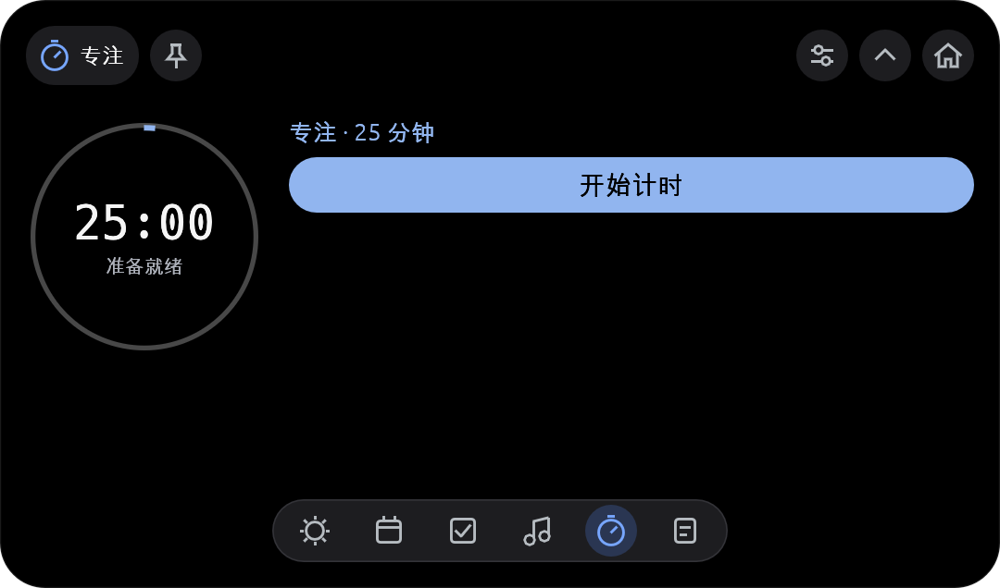

<div align="center">
  
  <h1>NotchCalendar</h1>
  <p>贴在 Windows 屏幕边缘的桌面胶囊。展开就能看日程、勾待办、切歌或开始专注。</p>
  <p>
    <a href="#下载安装"><strong>下载 Windows 版</strong></a>
    · <a href="docs/source-guide.md">使用指南</a>
    · <a href="CHANGELOG.md">更新记录</a>
    · <a href="https://github.com/GpsLypy/windao/issues">反馈问题</a>
  </p>
  <p>Windows 11 x64 · Rust / egui · MIT</p>
</div>

**功能一览** · [四边停靠](#四边停靠) · [日历与待办](#日历与待办) · [音乐与歌词](#音乐与歌词) · [通知记录](#通知记录) · [专注与健康提醒](#专注与健康提醒) · [文件与剪贴板](#文件与剪贴板) · [桌面工具](#桌面工具)

## 四边停靠

平时只占屏幕边缘一小条。鼠标靠近或按 **Ctrl + Shift + Space**，就能展开查看今天的日程、待办和专注状态。


*以下图片由 Windows 版实际使用的 Rust 界面在 macOS 上离屏渲染。日程、待办和播放信息使用示例数据，系统开关状态用于展示布局。Windows 实机使用系统字体。*

- **换边或跨屏**。按住 Ctrl 拖动收起的胶囊即可换边，也可以在设置中指定显示器、停靠位置和缩放。
- **按习惯显示**。可设为极简或半透明外观，选择 12／24 小时制，拖动调整胶囊内的页面顺序。
- **给当前应用让位**。浏览器或指定应用挡住胶囊时，胶囊收成贴边细线。可选 OLED 像素偏移，以及在兼容的截图和录屏工具中隐藏胶囊。

## 日历与待办

打开胶囊的「今天」看当天安排，或进工作台查看整月日历、时间线和待办四象限。


| 想做的事 | 在哪里操作 |
| --- | --- |
| 看今天有哪些安排 | 在「日历」选中日期，看当天事项、农历和节气。农历与节气支持离线查看 |
| 连接已有日历 | 在「日历来源」添加 HTTPS ICS 订阅或 CalDAV。远程日历只读，刷新失败时保留上次成功结果 |
| 新建或搬运日程 | 新建本地日程并选择开始、结束时间，或导入和导出 `.ics` 文件 |
| 分清轻重缓急 | 在「待办」切换列表、四象限、日历或统计。可设每周重复，在胶囊里直接完成当天待办，也可导入岛仔待办 |

## 音乐与歌词

「音乐」从 Windows 系统媒体会话读取曲名、歌手、封面和播放进度。播放器提供相应控制时，可以**播放、暂停、切歌和拖动进度**。


- **展开看整首**。歌词可随播放进度滚动，也可以暂停跟随，手动阅读。
- **收起留一行**。顶部停靠时，胶囊可在收起状态显示当前歌词。
- **自己选歌词来源**。可导入本地 LRC，或在音乐页点「在线查找歌词」向 LRCLIB 查询。播放控制和歌词匹配随播放器、曲目而异。

## 通知记录

工作台的「通知」可以回看最近 **100 条 NotchCalendar 提醒**，包括日程、待办和专注计时提醒。

要记录聊天工具的提示，在 **工作台 → 通知 → 第三方任务栏提示** 开启「记录任务栏闪烁」。支持微信、企业微信、飞书和钉钉。记录只包含通过应用签名验证的来源名称与闪烁时间，两类记录可分别清空。

## 专注与健康提醒

在胶囊或工作台开始专注计时，收起后仍能查看剩余时间。完成的专注会留下记录。在「专注」还可以分别设置饮水、起身提醒的间隔，手动记录当天喝水次数。



## 工作台

打开「今天」可查看下一项日程、接下来的空档，以及当天已专注的分钟数和完成的待办数。可用时间按 09:00–18:00 计算，每项定时日程前后各预留 5 分钟。


## 设置

在工作台左下角打开「设置」，可更改启动、提醒、主题和展开方式。左栏可切换到胶囊外观、功能页面、自动避让、数据与备份和关于。窄窗口可从顶部选择分类。


## 文件与剪贴板

- **文件暂存**。把文件路径收集到「工具」页，之后可打开文件或定位原位置。移除暂存只会移除引用。
- **剪贴板历史**。开启后可找回本次运行最近复制的 30 条文字，选中即可再次复制。记录随退出清空。
- **便笺、卡片与会议笔记**。直接在工作台整理内容，数据保存在本机。

## 桌面工具

| 功能 | 能看到什么 |
| --- | --- |
| 系统性能与世界时钟 | CPU、内存、实时网速、本地时间与常用时区 |
| 我的日子 | 纪念日、截止日期距今天还有多久，或已经过去几天 |
| 天气 | 搜索城市，查看 Open-Meteo 实况与未来七天预报 |
| 无线设备 | 查看 Windows 已配对的蓝牙设备，按需读取兼容设备的电量 |
| 现货金价与工时收入 | 手动刷新美元现货金价，按自设日薪和工时估算当日收入进度 |
| 插件集市 | 安装随包模板或在线目录组件，也可导入本地文本、链接和清单组件。[组件格式](docs/widget-manifest.md) |

## 下载安装

从 [GitHub Releases](https://github.com/GpsLypy/windao/releases) 下载 Windows 11 x64 预览包。

| 下载文件 | 使用方式 |
| --- | --- |
| `*-Setup.exe` | 双击安装，再从开始菜单或托盘打开工作台 |
| `*.zip` | 完整解压后运行应用。0.1.1 起的入口为 `NotchCalendar.exe`，0.1.0 的入口为 `WinDao.exe` |
| `*.sha256` | 可用 PowerShell 的 `Get-FileHash -Algorithm SHA256` 核对下载文件 |

可下载的版本和对应文件以 Releases 页面为准。

<details>
<summary><b>本机数据与日历连接</b></summary>

工作区位于 `%APPDATA%\WinDao`，卸载保留数据。CalDAV 凭据和日历订阅地址由 Windows 数据保护机制保存，备份不包含连接凭据。旧版数据的导入方法见[使用指南](docs/source-guide.md#本机数据与迁移)。

</details>

<details>
<summary><b>从源码构建</b></summary>

在装有 Windows SDK、MSVC C++ 构建工具和 Rust 1.92 或更高版本的 Windows 上运行。

```powershell
cargo test --locked
cargo run --locked
cargo build --release --locked
```

使用 Python 3.11 或更高版本运行 `python package.py target/release/windao.exe` 生成 ZIP。安装 NSIS 3 后加 `--makensis makensis` 可同时生成安装包。

</details>

## 开源与致谢

NotchCalendar 的 Windows 源码位于 `GpsLypy/windao`，使用 [MIT](LICENSE) 许可。感谢[岛仔 · Daozai](https://github.com/Renly1994/xiaotang-daozai)提供功能与交互设计参考。[实现对照](docs/daozai-comparison.md)记录了对岛仔 v0.6.70 的文档与源码核对。[第三方依赖许可](THIRD_PARTY_NOTICES.txt)随安装包提供。
